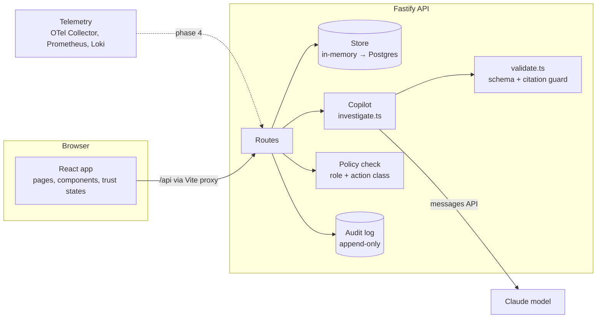

# Development pipeline

How to take Nexus AI from this starter to a deployed product you can demo in interviews, using VS Code and Claude Code. Each phase ends with a working, demoable app; stop at any phase and you still have something to show.

Exact prompts for each phase are in `CLAUDE_PROMPTS.md`.

---

## 1. Toolchain setup

| Tool | Why | Notes |
| --- | --- | --- |
| Node.js 20 LTS or newer | Runs API, web app and tooling | Check with `node -v` |
| Git and a GitHub account | Version control, CI, portfolio link | |
| VS Code 1.98 or newer | Editor | Required by the Claude Code extension |
| Claude Code extension | AI pair programmer inside VS Code | Extensions view → search “Claude Code” (publisher: Anthropic) → Install → sign in |
| Claude Code CLI (optional) | Same agent in the terminal | macOS/Linux/WSL: `curl -fsSL https://claude.ai/install.sh \| bash`. Windows PowerShell: `irm https://claude.ai/install.ps1 \| iex` |
| Anthropic API key (optional) | Live copilot in the app itself | console.anthropic.com. The app works without one in scripted mode |
| Docker Desktop (phase 3+) | Postgres, OpenTelemetry Collector | Not needed for phases 0–2 |

Setup docs for Claude Code change often; check https://code.claude.com/docs/en/vs-code if anything differs. On Windows, using Git Bash or WSL as the VS Code terminal avoids most path issues.

When you open the repo, VS Code will offer the recommended extensions in `.vscode/extensions.json`. Accept them.

> Two different Claude things are involved. **Claude Code** (extension/CLI) helps you write the code and uses your Claude subscription or account. The **Anthropic API key** is used by the Nexus app at runtime to power its copilot, and is billed separately.

---

## 2. Architecture



**Request path for the flagship flow**

1. `POST /api/incidents/:id/investigate` builds a bounded prompt from the incident timeline and evidence, wrapping them as untrusted data.
2. The model returns JSON. `validateInvestigation` checks the schema, strips citations to unknown evidence and drops unsupported claims. If nothing survives, the result is an abstention.
3. The UI shows hypotheses (`hypothesis` state) linked to evidence (`observed` state).
4. `POST /api/actions/:id/approve` checks the approver’s role on the server, then records the approval.
5. `POST /api/actions/:id/execute` runs as a scoped service identity, verifies the outcome, and writes every step to the audit log.

**Why this shape:** the separation between *what the AI recommends* (copilot) and *what the system may execute* (policy + action layer) is the core architectural decision from the product strategy. Keep it when you swap out pieces.

---

## 3. The build loop (use this for every change)

```
Explore → Plan → Build small → Verify → Review → Commit
```

1. **Explore.** Ask Claude Code to read the relevant files and explain how the feature currently works. Don’t let it write code yet.
2. **Plan.** Ask for a plan: files to change, approach, test to add, risks. Push back on anything that breaks the rules in `CLAUDE.md`. Approve the plan.
3. **Build small.** One concern at a time. If a change touches more than ~5 files, split it.
4. **Verify.** `npm run check`, then click through the flow in the browser. Ask Claude to run the checks and fix failures itself.
5. **Review.** Read the diff in VS Code’s Source Control panel. Use `/review-trust` (a project command) for anything touching AI output or actions.
6. **Commit.** Conventional Commit message, push, let CI run.

Habits that make Claude Code far more effective here:

- Keep `CLAUDE.md` current. It’s loaded at the start of every session, so rules written there don’t need repeating.
- Reference files explicitly (“in `apps/web/src/features/incident/CopilotPanel.tsx`…”).
- Paste error output and screenshots; it’s faster than describing them.
- Start a fresh conversation per feature so old context doesn’t leak in.
- When it goes in circles, stop, revert (`git restore .`), and restate the goal with a narrower scope.

### Branching and commits

- `main` is always deployable. Work on `feat/<short-name>`, `fix/<short-name>`, `docs/<short-name>`.
- Open a pull request even when working alone; CI runs on it and the PR description becomes portfolio evidence of your process.
- Commit messages: `feat(copilot): abstain when no traces are connected`.

---

## 4. Phases

Timings assume a few focused hours a day. Each phase lists the goal, the work, and the definition of done.

### Phase 0. Run the starter (day 1)

- Unzip, `git init`, first commit, push to a new GitHub repo.
- `npm install`, `npm run dev`, walk the flagship flow in `README.md`.
- Ask Claude Code to explain the architecture back to you (prompt 0.1). This is how you learn the codebase fast.

**Done when:** the app runs locally, CI is green on GitHub, and you can explain the request path above in your own words.

### Phase 1. Make it yours and polish the UI (week 1)

- Add your name and a short “About this project” page linking to your case study.
- Walk every screen in light and dark mode at 1440 px and 390 px. Log issues, then fix them with Claude in small batches.
- Add keyboard shortcuts for incident triage (`j`/`k` to move, `Enter` to open).
- Run an accessibility pass (axe DevTools browser extension) and fix what it finds.

**Done when:** every screen has loading, empty, error and permission-denied states; no axe violations on the flagship flow; screenshots ready for the portfolio.

### Phase 2. Live copilot and evaluation harness (week 2)

This is the most important phase for an AI PM portfolio.

- Add your API key, run INC-2048 in live mode, compare with the scripted output.
- Create `apps/api/eval/fixtures/`: 10–20 incidents with the known root cause and the evidence that should be cited. Write some where the right answer is to abstain.
- Add `npm run eval` that runs the copilot over every fixture and reports: root cause in top 3, citation precision (cited ids that are genuinely relevant), abstention correctness, dropped-claim count, latency, token cost.
- Add 5 prompt-injection fixtures (instructions hidden in log lines). The eval fails if behaviour changes.
- Iterate on the system prompt. Commit each version with its eval scores in the message.
- Show the latest eval results in **Control center → AI quality** from a generated JSON file instead of hard-coded numbers.

**Done when:** `npm run eval` produces a scorecard; you have a table of prompt versions vs. scores you can show in an interview.

### Phase 3. Persistence (week 3)

- Add Postgres via `docker-compose.yml`, and an ORM (Drizzle or Prisma; pick one with Claude and record why in `docs/decisions/`).
- Move incidents, actions, audit and events behind the same `store` functions so routes don’t change.
- Enforce append-only audit in the database (revoke `UPDATE`/`DELETE` on the audit table for the app role).
- Replace `useApi` with TanStack Query if caching or refetching gets complicated.

**Done when:** data survives restarts, `store` has tests against a test database, audit rows can’t be edited by the app.

### Phase 4. Real telemetry (weeks 4–5)

- Run a small instrumented demo system locally (the OpenTelemetry project publishes a multi-service demo; or build two tiny services with OTel SDKs).
- Add an OpenTelemetry Collector exporting metrics to Prometheus and logs to Loki (Docker Compose).
- Build a connector layer in the API: `connectors/prometheus.ts`, `connectors/loki.ts`, each with a typed interface and a fake for tests.
- Implement alert correlation: group alerts within a time window that share a service or a dependency edge. Unit-test it with fixtures.
- Inject a fault (e.g. lower a timeout via config), and watch Nexus detect, correlate and investigate it end to end.

**Done when:** a fault you inject shows up as one correlated incident with real evidence the copilot cites. Record this; it’s your strongest demo.

### Phase 5. Identity and governance (week 6)

- Add sign-in (a hosted auth provider or simple JWT for the demo) and roles.
- Move policy checks into a small policy module with tests for each action class.
- Permission-aware retrieval: the copilot only receives evidence the signed-in user can see; add an eval case proving it.
- Show per-user approval history and blind-approval rate in Control center.

**Done when:** two demo users with different roles see different evidence and different approval rights, verified by tests.

### Phase 6. Quality gates (ongoing, formalise in week 6)

- Playwright end-to-end test of the flagship flow, including the failure-and-retry path and the permission-denied path.
- Accessibility check in CI (axe with Playwright).
- Visual check of key screens in both themes.
- Add the eval suite to CI on a schedule (nightly), not on every push, to control API cost.

**Done when:** CI blocks merges on typecheck, unit, e2e and accessibility failures.

### Phase 7. Ship and package (week 7)

- Add a `DEMO_MODE` flag that forces scripted copilot and seeded data, so the public demo never spends your API budget.
- Deploy the web app to a static host (Vercel, Netlify or Cloudflare Pages) and the API to a container host (Render, Fly.io or Railway). Set secrets in the host, never in the repo.
- Add a reset-every-hour job so visitors always see the clean scenario.
- Record a 3-minute walkthrough: problem, flagship flow, abstention, failure handling, audit, eval scorecard.
- Link the live demo, repo and video from your portfolio case study.

**Done when:** a stranger can open one link and complete the flagship flow without instructions.

---

## 5. Testing strategy

| Layer | Tool | What to cover |
| --- | --- | --- |
| Unit | Vitest | Validation guardrail, correlation, policy checks, formatters |
| API | Vitest + Fastify `inject` | Status codes, 403 on missing role, 409 on invalid transitions, audit written |
| End to end | Playwright | Flagship flow, failure + retry, abstention, permission denied |
| Accessibility | axe + Playwright | Flagship flow screens, both themes |
| AI quality | `npm run eval` | Top-3 accuracy, citation precision, abstention, injection resistance, latency, cost |

The AI eval is a product artefact, not just a test. Treat changes to the prompt or model like a release: run the eval, compare, write down the decision.

---

## 6. CI/CD

`.github/workflows/ci.yml` runs on every push and pull request: install, typecheck, unit tests, build. Extend it as phases add test types.

Deployment (phase 7): merge to `main` → host auto-deploys web and API. Keep `ANTHROPIC_API_KEY` only in the API host’s secret store.

---

## 7. Portfolio checklist

- [ ] Live demo link that works without explanation
- [ ] 3-minute walkthrough video
- [ ] Eval scorecard with at least three prompt versions compared
- [ ] Two or three decision records in `docs/decisions/` (one page each: context, options, decision, consequences)
- [ ] Screenshots: overview, incident with copilot, abstention, approval, audit log, agent studio
- [ ] Case study page updated: change “Hypothesis” tags to “Built” for everything you shipped
